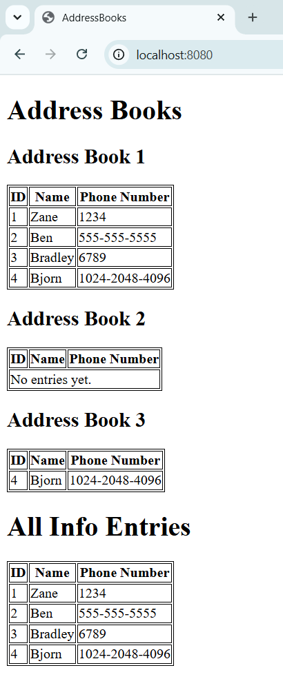

Student: Zane Labonte-Hagar, 101239002

## Steps

### 1. Start the server
Open the project in IntelliJ IDEA and run `com.github.konicai.Sysc4806LabApplication` using an IntelliJ IDEA run configuration.

Alternatively, run `mvn spring-boot:run`.

See [Example Server Logs](#example-server-logs) for an example of log output of the server.


### 2. Access the REST API

The REST API was automatically created using the `spring-boot-starter-data-rest` dependency as described in the lab manual.

Here is an example:

#### GET all AddressBooks
```
$ curl -X GET http://localhost:8080/addressBooks
{
  "_embedded" : {
    "addressBooks" : [ {
      "_links" : {
        "self" : {
          "href" : "http://localhost:8080/addressBooks/1"
        },
        "addressBook" : {
          "href" : "http://localhost:8080/addressBooks/1"
        },
        "info" : {
          "href" : "http://localhost:8080/addressBooks/1/info"
        }
      }
    }, {
      "_links" : {
        "self" : {
          "href" : "http://localhost:8080/addressBooks/2"
        },
        "addressBook" : {
          "href" : "http://localhost:8080/addressBooks/2"
        },
        "info" : {
          "href" : "http://localhost:8080/addressBooks/2/info"
        }
      }
    } ]
  },
  "_links" : {
    "self" : {
      "href" : "http://localhost:8080/addressBooks"
    },
    "profile" : {
      "href" : "http://localhost:8080/profile/addressBooks"
    }
  }
}
```

#### GET all BuddyInfo entries
```
$ curl -X GET http://localhost:8080/buddyInfoes
{
  "_embedded" : {
    "buddyInfoes" : [ {
      "_links" : {
        "self" : {
          "href" : "http://localhost:8080/buddyInfoes/1"
        },
        "buddyInfo" : {
          "href" : "http://localhost:8080/buddyInfoes/1"
        }
      },
      "name" : "Zane",
      "phoneNumber" : "1234"
    }, {
      "_links" : {
        "self" : {
          "href" : "http://localhost:8080/buddyInfoes/2"
        },
        "buddyInfo" : {
          "href" : "http://localhost:8080/buddyInfoes/2"
        }
      },
      "name" : "Ben",
      "phoneNumber" : "555-555-5555"
    }, {
      "_links" : {
        "self" : {
          "href" : "http://localhost:8080/buddyInfoes/3"
        },
        "buddyInfo" : {
          "href" : "http://localhost:8080/buddyInfoes/3"
        }
      },
      "name" : "Bradley",
      "phoneNumber" : "6789"
    } ]
  },
  "_links" : {
    "self" : {
      "href" : "http://localhost:8080/buddyInfoes"
    },
    "profile" : {
      "href" : "http://localhost:8080/profile/buddyInfoes"
    }
  }
}
```

#### POST new AddressBook
```
$ curl --json '{}' http://localhost:8080/addressBooks
{
  "_links" : {
    "self" : {
      "href" : "http://localhost:8080/addressBooks/3"
    },
    "addressBook" : {
      "href" : "http://localhost:8080/addressBooks/3"
    },
    "info" : {
      "href" : "http://localhost:8080/addressBooks/3/info"
    }
  }
}
```

#### POST new BuddyInfo
```
$ curl --json '{"name": "Bjorn", "phoneNumber": "1024-2048-4096"}' http://localhost:8080/buddyInfoes
{
  "_links" : {
    "self" : {
      "href" : "http://localhost:8080/buddyInfoes/4"
    },
    "buddyInfo" : {
      "href" : "http://localhost:8080/buddyInfoes/4"
    }
  },
  "name" : "Bjorn",
  "phoneNumber" : "1024-2048-4096"
}
```

#### POST the new BuddyInfo into the new AddressBook
```
curl -i -X POST http://localhost:8080/addressBooks/3/info -H "Content-Type: text/uri-list" -d "http://localhost:8080/buddyInfoes/4"
```

#### GET the result of the previous addition
```
$ curl http://localhost:8080/addressBooks/3/info
{
  "_embedded" : {
    "buddyInfoes" : [ {
      "_links" : {
        "self" : {
          "href" : "http://localhost:8080/buddyInfoes/4"
        },
        "buddyInfo" : {
          "href" : "http://localhost:8080/buddyInfoes/4"
        }
      },
      "name" : "Bjorn",
      "phoneNumber" : "1024-2048-4096"
    } ]
  },
  "_links" : {
    "self" : {
      "href" : "http://localhost:8080/addressBooks/3/info"
    }
  }
}
```

### 3. Access the demo web page

Access the demo web page at `http://localhost:8080/`. You should see something like the following:

[]()

## Example Server Logs

```
  .   ____          _            __ _ _
 /\\ / ___'_ __ _ _(_)_ __  __ _ \ \ \ \
( ( )\___ | '_ | '_| | '_ \/ _` | \ \ \ \
 \\/  ___)| |_)| | | | | || (_| |  ) ) ) )
  '  |____| .__|_| |_|_| |_\__, | / / / /
 =========|_|==============|___/=/_/_/_/

 :: Spring Boot ::                (v4.1.1)

2026-10-07T21:33:41.495-04:00  INFO 13552 --- [sysc4806-lab3] [           main] c.github.konicai.Sysc4806LabApplication  : Starting Sysc4806LabApplication using Java 21.0.6 with PID 13552 (C:\Users\zlabo\Documents\classes\sysc4806\lab4\target\classes started by zlabo in C:\Users\zlabo\Documents\classes\sysc4806\lab4)
2026-10-07T21:33:41.498-04:00  INFO 13552 --- [sysc4806-lab3] [           main] c.github.konicai.Sysc4806LabApplication  : No active profile set, falling back to 1 default profile: "default"
2026-10-07T21:33:41.919-04:00  INFO 13552 --- [sysc4806-lab3] [           main] .s.d.r.c.RepositoryConfigurationDelegate : Bootstrapping Spring Data JPA repositories in DEFAULT mode.
2026-10-07T21:33:41.948-04:00  INFO 13552 --- [sysc4806-lab3] [           main] .s.d.r.c.RepositoryConfigurationDelegate : Finished Spring Data repository scanning in 25 ms. Found 2 JPA repository interfaces.
2026-10-07T21:33:42.236-04:00  INFO 13552 --- [sysc4806-lab3] [           main] o.s.boot.tomcat.TomcatWebServer          : Tomcat initialized with port 8080 (http)
2026-10-07T21:33:42.245-04:00  INFO 13552 --- [sysc4806-lab3] [           main] o.apache.catalina.core.StandardService   : Starting service [Tomcat]
2026-10-07T21:33:42.246-04:00  INFO 13552 --- [sysc4806-lab3] [           main] o.apache.catalina.core.StandardEngine    : Starting Servlet engine: [Apache Tomcat/11.0.24]
2026-10-07T21:33:42.279-04:00  INFO 13552 --- [sysc4806-lab3] [           main] b.w.c.s.WebApplicationContextInitializer : Root WebApplicationContext: initialization completed in 753 ms
2026-10-07T21:33:42.372-04:00  INFO 13552 --- [sysc4806-lab3] [           main] com.zaxxer.hikari.HikariDataSource       : HikariPool-1 - Starting...
2026-10-07T21:33:42.486-04:00  INFO 13552 --- [sysc4806-lab3] [           main] com.zaxxer.hikari.pool.HikariPool        : HikariPool-1 - Added connection conn0: url=jdbc:h2:mem:67769c10-6a3a-4a1d-8ffb-1095d30e50b1 user=SA
2026-10-07T21:33:42.487-04:00  INFO 13552 --- [sysc4806-lab3] [           main] com.zaxxer.hikari.HikariDataSource       : HikariPool-1 - Start completed.
2026-10-07T21:33:42.510-04:00  INFO 13552 --- [sysc4806-lab3] [           main] org.hibernate.orm.jpa                    : HHH008540: Processing PersistenceUnitInfo [name: default]
2026-10-07T21:33:42.545-04:00  INFO 13552 --- [sysc4806-lab3] [           main] org.hibernate.orm.core                   : HHH000001: Hibernate ORM core version 7.4.5.Final
2026-10-07T21:33:42.835-04:00  INFO 13552 --- [sysc4806-lab3] [           main] o.s.o.j.p.SpringPersistenceUnitInfo      : No LoadTimeWeaver setup: ignoring JPA class transformer
2026-10-07T21:33:42.889-04:00  INFO 13552 --- [sysc4806-lab3] [           main] org.hibernate.orm.connections.pooling    : HHH10001005: Database info:
	Database JDBC URL [jdbc:h2:mem:67769c10-6a3a-4a1d-8ffb-1095d30e50b1]
	Database driver: H2 JDBC Driver
	Database dialect: H2Dialect
	Database version: 2.5.250
	Default catalog/schema: 67769C10-6A3A-4A1D-8FFB-1095D30E50B1/PUBLIC
	Autocommit mode: undefined/unknown
	Isolation level: READ_COMMITTED [default READ_COMMITTED]
	JDBC fetch size: 100
	Pool: DataSourceConnectionProvider
	Minimum pool size: undefined/unknown
	Maximum pool size: undefined/unknown
2026-10-07T21:33:43.503-04:00  INFO 13552 --- [sysc4806-lab3] [           main] org.hibernate.orm.core                   : HHH000489: No JTA platform available (set 'hibernate.transaction.jta.platform' to enable JTA platform integration)
2026-10-07T21:33:43.537-04:00  INFO 13552 --- [sysc4806-lab3] [           main] j.LocalContainerEntityManagerFactoryBean : Initialized JPA EntityManagerFactory for persistence unit 'default'
2026-10-07T21:33:43.581-04:00  INFO 13552 --- [sysc4806-lab3] [           main] o.s.d.j.r.query.QueryEnhancerFactories   : Hibernate is in classpath; If applicable, HQL parser will be used.
2026-10-07T21:33:43.708-04:00  WARN 13552 --- [sysc4806-lab3] [           main] JpaBaseConfiguration$JpaWebConfiguration : spring.jpa.open-in-view is enabled by default. Therefore, database queries may be performed during view rendering. Explicitly configure spring.jpa.open-in-view to disable this warning
2026-10-07T21:33:44.066-04:00  INFO 13552 --- [sysc4806-lab3] [           main] o.s.boot.tomcat.TomcatWebServer          : Tomcat started on port 8080 (http) with context path '/'
2026-10-07T21:33:44.070-04:00  INFO 13552 --- [sysc4806-lab3] [           main] c.github.konicai.Sysc4806LabApplication  : Started Sysc4806LabApplication in 2.848 seconds (process running for 3.335)
2026-10-07T21:33:44.101-04:00  INFO 13552 --- [sysc4806-lab3] [           main] c.github.konicai.Sysc4806LabApplication  : BuddyInfo persistence test
2026-10-07T21:33:44.229-04:00  INFO 13552 --- [sysc4806-lab3] [           main] c.github.konicai.Sysc4806LabApplication  : All BuddyInfo:
2026-10-07T21:33:44.229-04:00  INFO 13552 --- [sysc4806-lab3] [           main] c.github.konicai.Sysc4806LabApplication  : Name: Zane, Phone Number: 1234
2026-10-07T21:33:44.230-04:00  INFO 13552 --- [sysc4806-lab3] [           main] c.github.konicai.Sysc4806LabApplication  : Name: Ben, Phone Number: 555-555-5555
2026-10-07T21:33:44.230-04:00  INFO 13552 --- [sysc4806-lab3] [           main] c.github.konicai.Sysc4806LabApplication  : 
2026-10-07T21:33:44.230-04:00  INFO 13552 --- [sysc4806-lab3] [           main] c.github.konicai.Sysc4806LabApplication  : AddressBook persistence test
2026-10-07T21:33:44.240-04:00  INFO 13552 --- [sysc4806-lab3] [           main] c.github.konicai.Sysc4806LabApplication  : All BuddyInfo:
2026-10-07T21:33:44.240-04:00  INFO 13552 --- [sysc4806-lab3] [           main] c.github.konicai.Sysc4806LabApplication  : Name: Zane, Phone Number: 1234
2026-10-07T21:33:44.240-04:00  INFO 13552 --- [sysc4806-lab3] [           main] c.github.konicai.Sysc4806LabApplication  : Name: Ben, Phone Number: 555-555-5555
2026-10-07T21:33:44.240-04:00  INFO 13552 --- [sysc4806-lab3] [           main] c.github.konicai.Sysc4806LabApplication  : Name: Bradley, Phone Number: 6789
2026-10-07T21:33:44.240-04:00  INFO 13552 --- [sysc4806-lab3] [           main] c.github.konicai.Sysc4806LabApplication  : 
2026-10-07T21:33:44.242-04:00  INFO 13552 --- [sysc4806-lab3] [           main] c.github.konicai.Sysc4806LabApplication  : All AddressBook:
2026-10-07T21:33:44.243-04:00  INFO 13552 --- [sysc4806-lab3] [           main] c.github.konicai.Sysc4806LabApplication  : AddressBook:
Name: Zane, Phone Number: 1234
Name: Ben, Phone Number: 555-555-5555
Name: Bradley, Phone Number: 6789
2026-10-07T21:33:44.243-04:00  INFO 13552 --- [sysc4806-lab3] [           main] c.github.konicai.Sysc4806LabApplication  : 
2026-10-07T21:33:49.785-04:00  INFO 13552 --- [sysc4806-lab3] [nio-8080-exec-1] o.a.c.c.C.[Tomcat].[localhost].[/]       : Initializing Spring DispatcherServlet 'dispatcherServlet'
2026-10-07T21:33:49.785-04:00  INFO 13552 --- [sysc4806-lab3] [nio-8080-exec-1] o.s.web.servlet.DispatcherServlet        : Initializing Servlet 'dispatcherServlet'
2026-10-07T21:33:49.785-04:00  INFO 13552 --- [sysc4806-lab3] [nio-8080-exec-1] o.s.web.servlet.DispatcherServlet        : Completed initialization in 0 ms
```
